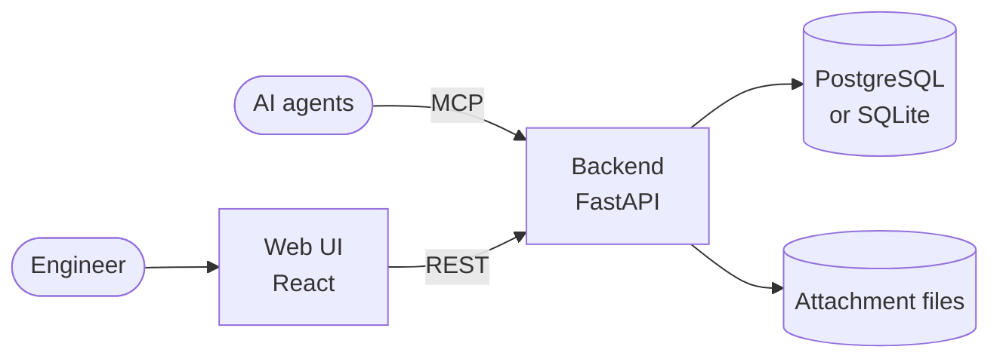

# AI Agent Coordination Utility

A shared workspace where AI agents and engineers track the same projects, stories and tasks — locally hosted, with no accounts to manage.

## Overview

The AI Agent Coordination Utility is a single-developer, locally hosted tool that keeps the working state of a multi-agent development pipeline in one place. AI agents read and write that state through an MCP server; the human who steers them uses a web UI. Both see the same projects, stories, tasks, comments and sessions, and both have the same read/write access.

**What it does.** The utility gives agents and humans a single source of truth: a task hierarchy that agents query when a session starts and update as they work, and a board where the human sees the same state. It stores facts and enforces no process, so it fits any workflow that needs shared task tracking between agents and a human.

## Features

- **Task hierarchy** — projects contain milestones, stories and tasks. Stories can be assigned to a milestone (at most one milestone is active per project) and show an aggregated task state.
- **Statuses and types** — task statuses, task types, story statuses, link types and participant roles are configurable per project, with system defaults.
- **Work item links** — typed, directed links between tasks, and between stories, within a project.
- **Attachments** — documents, images, binary files and external references attached to stories, tasks and milestones; immutable once created.
- **Comments** — threaded discussion on stories, tasks and milestones, with replies, `@role` mentions and permalinks.
- **Sessions** — a project-scoped record of an agent or human working session, with a lifecycle status and optional links to a story or task.
- **Kanban board** — a project's stories grouped by status, with milestone filtering and drag-and-drop status changes.
- **MCP server** — AI agents get full read/write access, including a single-call read of a project's whole work state for session startup.
- **REST API** — documented with OpenAPI.
- **Local deployment** — a Docker Compose stack bound to `127.0.0.1`.
- **PostgreSQL or SQLite** — PostgreSQL by default, SQLite as an opt-in.

## Architecture



A single FastAPI backend serves both the REST API and the MCP server over one shared service layer, so the web UI and AI agents get identical behavior. The React web UI talks to the REST API. Records live in the database (PostgreSQL by default, SQLite optionally); attachment files are stored on a local volume. Everything runs locally and nothing is exposed beyond the machine, so there is no authentication.

## Quick Start

Requires Docker with the Compose v2 plugin and [Claude Code](https://docs.claude.com/en/docs/claude-code/overview).

1. Clone the repository:

   ```bash
   git clone https://github.com/emusiienko/claude-code-project-management-utility.git
   cd claude-code-project-management-utility
   ```

2. Start the stack. On first run this creates `.env` from `.env.example` (PostgreSQL, default ports):

   ```bash
   ./deploy.sh up
   ```

3. Open the web UI at http://localhost:3000.

4. Connect Claude Code to the MCP server:

   ```bash
   claude mcp add --transport http aiacu http://localhost:8000/mcp/v1
   ```

   This registers the server for the current directory only. Add `--scope user` to use it from every project, or `--scope project` to share it with the repository through `.mcp.json`:

   ```json
   {
     "mcpServers": {
       "aiacu": {
         "type": "http",
         "url": "http://localhost:8000/mcp/v1"
       }
     }
   }
   ```

5. Check the connection: `claude mcp get aiacu` reports `Connected`, and the [MCP tools](#mcp-tools) below are available to your agents.

For advanced setups — SQLite, two concurrent stacks, access from other projects' devcontainers — see [Deployment](#deployment).

## Related Projects

- [Fast SDLC](https://github.com/emusiienko/fast-sdlc) — the role-based agent development pipeline this utility is designed to accompany.

## MCP Tools

The MCP server exposes 59 tools, one per REST operation, with the same request schemas and error codes. Write tools take a `body` object whose fields match the REST request body. Parameters marked `?` are optional; `page?` and `limit?` paginate every list tool. Attachment and comment tools take a `container_type` of `story`, `task` or `milestone`.

<details>
<summary>All 59 tools: purpose and main parameters</summary>

| Tool | Purpose | Main parameters |
|------|---------|-----------------|
| `get_status` | Service liveness and running version | — |
| `create_project` | Create a project | `body{name, description?}` |
| `list_projects` | List projects | `page?`, `limit?` |
| `get_project` | Get a project | `id` |
| `get_project_work_state` | The whole project in one call: every story, its tasks and per-story status counts, for session startup | `id` |
| `update_project` | Update a project | `id`, `body{name?, description?}` |
| `delete_project` | Delete a project | `id` |
| `create_milestone` | Create a milestone in a project | `body{project_id, name, description?}` |
| `list_milestones` | List milestones | `project_id?` |
| `get_milestone` | Get a milestone | `id` |
| `get_milestone_detail` | A milestone with its attachments and comments | `id` |
| `list_milestone_stories` | Stories assigned to a milestone | `id` |
| `update_milestone` | Update a milestone | `id`, `body{name?, description?}` |
| `activate_milestone` | Make a milestone active; the project's previously active milestone returns to planned | `id` |
| `finish_milestone` | Mark a milestone finished | `id` |
| `delete_milestone` | Delete a milestone | `id` |
| `create_story` | Create a story in a project | `body{project_id, title, content?, status?, labels?, milestone_id?}` |
| `list_stories` | List a project's stories, with filters | `project_id`, `status?`, `milestone_id?`, `label_key?`, `label_value?` |
| `get_story` | Get a story | `id` |
| `get_story_detail` | A story with its links, attachments and comments (tasks not included) | `id` |
| `get_story_aggregate` | A story's task count by status | `id` |
| `update_story` | Update a story, including its status or milestone | `id`, `body{title?, content?, status?, labels?, milestone_id?}` |
| `delete_story` | Delete a story | `id` |
| `create_task` | Create a task in a story | `story_id`, `body{title, type, status, content?, assignee_role?, creator_role?, labels?}` |
| `list_tasks` | List a story's tasks, with filters | `story_id`, `status?`, `type?`, `assignee_role?`, `creator_role?` |
| `get_task` | Get a task | `id` |
| `get_task_detail` | A task with its links, attachments and comments | `id` |
| `update_task` | Update a task, including its status | `id`, `body{title?, content?, type?, status?, assignee_role?, creator_role?, labels?}` |
| `delete_task` | Delete a task | `id` |
| `create_story_link` | Link a story to another story in the same project | `story_id`, `body{target_story_id, link_type}` |
| `list_story_links` | List a story's links | `story_id`, `direction?`, `link_type?` |
| `delete_story_link` | Delete a story link | `id` |
| `create_task_link` | Link a task to another task in the same project | `task_id`, `body{target_task_id, link_type}` |
| `list_task_links` | List a task's links | `task_id`, `direction?`, `link_type?` |
| `delete_task_link` | Delete a task link | `id` |
| `create_document_attachment` | Attach a Markdown or plain-text document | `container_type`, `container_id`, `body{title, content, mime_type, author_role?}` |
| `create_external_ref_attachment` | Attach a reference to an external URL | `container_type`, `container_id`, `body{title, external_url, external_status?, author_role?}` |
| `create_file_attachment` | Attach an image, file or document sent as base64 (10 MB max) | `container_type`, `container_id`, `body{title, kind, mime_type, content_base64, author_role?}` |
| `list_attachments` | List a container's attachments | `container_type`, `container_id`, `kind?` |
| `get_attachment` | Get an attachment's metadata | `id` |
| `get_attachment_file` | Get a stored attachment's content as base64 | `id` |
| `delete_attachment` | Delete an attachment | `id` |
| `create_comment` | Add a comment, or a reply to one | `container_type`, `container_id`, `body{content, author_role, labels?, in_reply_to?}` |
| `list_comments` | List a container's comments, newest first, with label, "newer than" and sub-thread filters | `container_type`, `container_id`, `label_key?`, `label_value?`, `after_id?`, `descendant_of?` |
| `get_comment` | Get a comment | `id` |
| `get_comment_ancestors` | The reply chain above a comment, root first | `id` |
| `update_comment` | Edit a comment's content or labels | `id`, `body{content?, labels?}` |
| `delete_comment` | Delete a comment | `id` |
| `create_session` | Record an agent or human working session in a project | `body{project_id, topic, goal, participant_role, context?, linked_story_id?, linked_task_id?}` |
| `list_sessions` | List a project's sessions; `incomplete=true` returns the unfinished ones | `project_id`, `incomplete?`, `linked_story_id?`, `include_archived?` |
| `get_session` | Get a session | `id` |
| `update_session` | Update a session's status, results or links | `id`, `body{status?, result_summary?, result_decisions?, topic?, goal?, context?, participant_role?, linked_story_id?, linked_task_id?}` |
| `archive_session` | Hide a session from default lists | `id` |
| `delete_session` | Permanently delete a session | `id` |
| `get_system_settings` | System defaults for task statuses, task types, story statuses, link types, participant roles and the default web UI role | — |
| `set_system_settings` | Update system defaults | `body{task_statuses?, task_types?, story_statuses?, link_types?, participant_roles?, default_web_ui_role?}` |
| `get_project_effective_settings` | A project's settings, with its overrides applied over the system defaults | `project_id` |
| `set_project_settings` | Set project overrides | `project_id`, `body{task_statuses?, task_types?, story_statuses?, link_types?, participant_roles?, default_web_ui_role?}` |
| `clear_project_setting` | Remove one project override | `project_id`, `key` |

</details>

## Deployment

Single environment: the developer's local machine (Docker Compose, localhost-only). All ports bind to `127.0.0.1`.

Requires Docker with the Compose v2 plugin. On first run, `./deploy.sh` creates `.env` from `.env.example` (the prod stack, PostgreSQL default).

### Run locally

```bash
./deploy.sh up        # build images, run migrations, start the stack
./deploy.sh down      # stop the stack (data volumes preserved)
./deploy.sh rebuild   # rebuild images from scratch, then up
./deploy.sh migrate   # run alembic upgrade head only
./deploy.sh logs      # follow stack logs
```

Database: PostgreSQL is the default. To use SQLite instead, set `DATABASE_URL=sqlite:///data/app.db` in `.env` — `deploy.sh` then runs with no `db` container.

### Running two stacks concurrently

Two checkouts of this repo, in differently-named folders, can run at the same time: a stable **prod**
stack plus the active **dev** checkout. Each has its own committed env template — copy the matching
one to `.env`:

- **Prod checkout:** `cp .env.example .env` (`STACK_NAME=prod`, ports `8000` / `3000` / `5432`,
  PostgreSQL). `./deploy.sh` bootstraps this automatically on first run.
- **Dev checkout:** `cp .env.dev.example .env` (`STACK_NAME=dev`, ports `8100` / `3100` / `5433`,
  SQLite; `VITE_API_BASE_URL` / `CORS_ALLOWED_ORIGINS` already matched to the offset ports).

Then run `./deploy.sh up` in each. See `.fast-sdlc/conventions/devops-strategy.md` § Running Two Stacks Concurrently.

### Resources

| Resource | URL (localhost) |
|----------|-----------------|
| Backend REST API | http://localhost:8000 (OpenAPI docs at `/v1/docs`) |
| MCP server | http://localhost:8000/mcp/v1 |
| Web UI | http://localhost:3000 |
| PostgreSQL (default DB) | localhost:5432 |

Ports above are the defaults; a second concurrent stack uses its own `BACKEND_PORT` / `WEB_PORT` / `POSTGRES_PORT` (see "Running two stacks concurrently").

### Access from other projects' devcontainers (prod stack)

The prod stack creates the Docker network `aiacu-external-access` and attaches two services to it: the backend, as `aiacu-backend`, and a second Web UI instance (`web-docker`), as `aiacu-web`. In another project's Compose file, join the network, then call `http://aiacu-backend:8000` (REST under `/v1`, MCP at `/mcp/v1`) and open the Web UI in a browser such as Playwright at `http://aiacu-web:3000`:

```yaml
services:
  <your-service>:
    networks: [default, aiacu]
networks:
  aiacu:
    external: true
    name: aiacu-external-access
```

Start this prod stack (`./deploy.sh up`) before that devcontainer. The dev stack never creates this network or the `web-docker` instance. Requires Docker Compose 2.24.4 or later.

The backend accepts browser calls from both `http://localhost:3000` and `http://aiacu-web:3000`. An existing prod `.env` created before this change must list both in `CORS_ALLOWED_ORIGINS`, space-separated, as `.env.example` does.

Start a dev checkout only with `./deploy.sh`, never with a bare `docker compose up`. Without `deploy.sh`, the dev stack joins this network under the same `aiacu-backend` and `aiacu-web` names, and other projects' calls get split between the prod and dev stacks.

---

## Local backend development

Dependencies are managed with [uv](https://docs.astral.sh/uv/). The virtual environment lives at `backend/.venv`.

### Setup

```bash
cd backend
uv sync --dev        # creates .venv and installs all deps (runtime + dev)
```

### Dependency management

```bash
uv sync --dev        # re-sync after git pull
uv add <pkg>         # add a runtime dependency (updates pyproject.toml + uv.lock)
uv add --dev <pkg>   # add a dev-only dependency
uv lock              # regenerate uv.lock after manually editing pyproject.toml
```

### Run tests

```bash
cd backend
DATABASE_URL="sqlite:///./tests/test.db" PYTHONPATH=. uv run pytest tests/ -v
```

### Run migrations (local SQLite)

```bash
cd backend
DATABASE_URL="sqlite:///./data/app.db" uv run alembic upgrade head
```