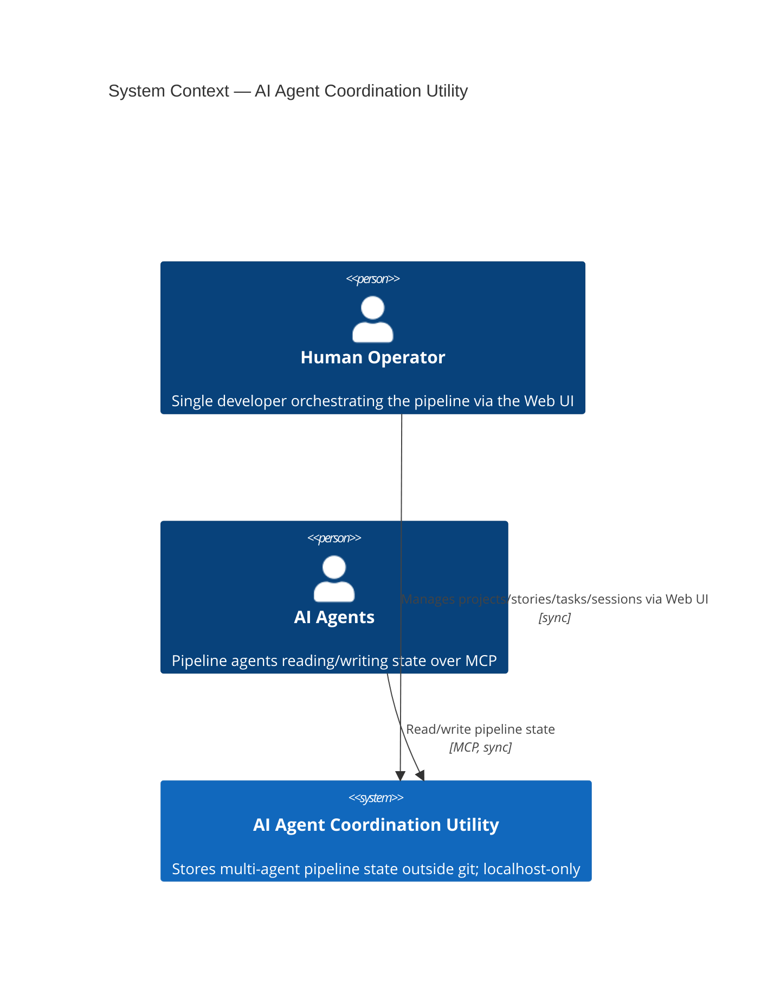
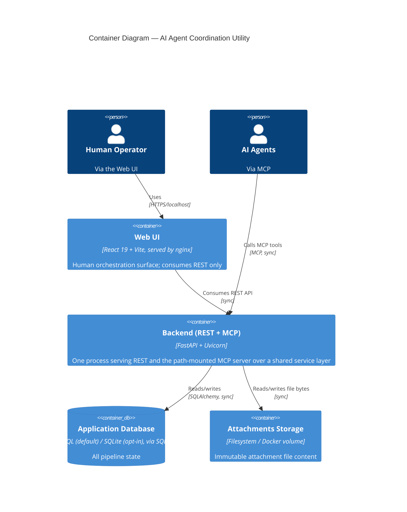

# Software Architecture Document

> Master/entry document of the Technical Documentation folder ([`documentation/technical/`](index.md)).
> Thin by design: it inlines only the C4 diagrams and short summary tables that give a readable whole,
> and references the live artifacts ([Solution Overview](solution-overview/solution-overview.md),
> [NFR](nfr.md), [Physical Data Model](data-models/physical-data-model.md),
> [API Contracts](api-contracts/coordination-service.md),
> [Deployment/Infrastructure View](deployment/deployment-infrastructure-view.md),
> [ADR Log](adr-log/)) rather than restating them. Kept current at every Reconcile.

## Introduction & Goals

The **AI Agent Coordination Utility** is a single-developer, locally-hosted tool that stores the
operational state of a multi-agent development pipeline (projects, stories, tasks, milestones,
sessions, links, attachments, comments, settings) **outside git**. That state is reachable two ways
over one shared core: by **AI agents** through an MCP server, and by the **human operator** through a
web UI. Both surfaces are behavior-identical because they call the same service layer.

Top quality goals: fast local CRUD/list responses, a genuinely DB-agnostic persistence layer
(PostgreSQL or SQLite from the same code), and simplicity over ceremony — the utility *stores facts*
and never enforces process. See [`nfr.md`](nfr.md) for the measurable targets.

## System Scope & Context

See [`solution-overview/solution-overview.md`](solution-overview/solution-overview.md) § System
Context and its graph data
([`system-context.yaml`](solution-overview/system-context.yaml)). C4 Level 1:

The boundary is deliberately narrow: no external runtime integrations, no third-party services. State
is stored outside git but git is not a runtime dependency.

## Solution Strategy

- **App-based modular monolith in a two-folder monorepo** (`backend/`, `frontend/`) — ADR-004.
- **One backend process, two surfaces**: REST and the **path-mounted MCP server** share a single port
  and a single service layer, so business logic lives once — ADR-003 (superseded by ADR-007), ADR-007.
  MCP is path-versioned like REST: served at `/mcp/v1`, one server instance per version — ADR-032.
- **DB-agnostic persistence**: SQLAlchemy 2.0 + Alembic run identically on PostgreSQL (deployment
  default) and SQLite (opt-in) — ADR-002, ADR-031.
- **React SPA** for the operator surface, justified by rich interactivity — ADR-006.
- **No authentication, by design**: the only access boundary is Docker localhost port mapping.

Full decision list in [`adr-log/`](adr-log/) (referenced by ID throughout — never restated here).

## Building Block View

See [`solution-overview/solution-overview.md`](solution-overview/solution-overview.md) § Key
Components and its graph data
([`key-components.yaml`](solution-overview/key-components.yaml)). C4 Level 2:

Backend internal structure (per-domain packages, thin controllers/MCP-tools over a shared service
layer, `core` for cross-cutting concerns) is detailed in
[Solution Overview](solution-overview/solution-overview.md) § Key Components; the persisted shape is
in [`data-models/physical-data-model.md`](data-models/physical-data-model.md).

## Runtime View

The two representative flows — the write path (REST or MCP → schema validation → service business
rules → dictionary validation → persist → envelope) and the composed read path (e.g. task detail
assembling links + attachments + comments in one service call) — are described in
[`solution-overview/solution-overview.md`](solution-overview/solution-overview.md) § Data Flow. Both
surfaces traverse the identical service path.

## Deployment View

See [`deployment/deployment-infrastructure-view.md`](deployment/deployment-infrastructure-view.md) —
single environment (developer's local machine), Docker Compose, localhost-only, with the prod/dev
concurrent-stack model (ADR-030) and PostgreSQL/SQLite selection (ADR-031). Concrete IaC is owned by
devops and is not described here.

## Quality Requirements

Summary only — full detail, Source, and Notes live in [`nfr.md`](nfr.md).

| Category | Target |
|---|---|
| API latency — single-resource CRUD | p95 < 200 ms |
| API latency — list (≤1,000 rows) | p95 < 500 ms |
| API latency — story aggregate (≤500 tasks) | < 300 ms |
| API latency — task detail (≤100 attachments + 200 comments) | < 500 ms |
| Concurrency | ≥5 concurrent requests, no degradation |
| Frontend — initial load | < 2 s |
| Frontend — client navigation | < 300 ms |
| Accessibility | WCAG 2.1 AA, all views |
| Supported platform | Desktop-only, min viewport 1,024 px |
| Rate limit | 1,000 req/min, all endpoints |
| Attachment upload size | ≤ 10 MB |
| Security posture | No auth by design — localhost-only access boundary |

## Architecture Decisions

Full records in [`adr-log/`](adr-log/). Next id: **ADR-033**.

> **Reading note.** Some ADR bodies cite document paths that no longer exist (in ADR-001, ADR-007,
> ADR-011, ADR-015, ADR-026). Those references are **deliberately not corrected**: an ADR body is
> immutable once written, and only its `Status` field may ever change — which is also why the ADR
> files themselves carry plain-ID cross-references rather than links. Read them as pointing at
> whatever now holds that content — this SAD and the artifacts it references, per
> [`index.md`](index.md).

| ID | Title | Status |
|---|---|---|
| [ADR-001](adr-log/ADR-001-backend-stack-python-fastapi.md) | Backend stack — Python + FastAPI | Accepted |
| [ADR-002](adr-log/ADR-002-db-agnostic-persistence.md) | DB-agnostic persistence — configurable SQLite / PostgreSQL | Accepted |
| [ADR-003](adr-log/ADR-003-mcp-shared-service-layer-http.md) | MCP topology — shared service layer, HTTP transport | Superseded by ADR-007 |
| [ADR-004](adr-log/ADR-004-app-based-monorepo.md) | App-based modular monolith + two-folder monorepo | Accepted |
| [ADR-005](adr-log/ADR-005-attachment-filesystem-storage.md) | Attachment content stored on the filesystem | Accepted (versioning clause retired by ADR-021) |
| [ADR-006](adr-log/ADR-006-frontend-react-spa.md) | Frontend as a React SPA | Accepted |
| [ADR-007](adr-log/ADR-007-mcp-path-mounted-shared-port.md) | MCP path-mounted on the shared backend port | Accepted |
| [ADR-008](adr-log/ADR-008-effective-dictionary-resolution.md) | Effective-dictionary resolution — override fully replaces, never merges | Accepted |
| [ADR-009](adr-log/ADR-009-system-defaults-seed-migration.md) | System dictionary defaults seeded via a dedicated data migration | Superseded by ADR-010 |
| [ADR-010](adr-log/ADR-010-dependency-ordered-migrations-bundled-seed.md) | Dependency-ordered migrations, root-first, inline FKs, bundled seed | Accepted |
| [ADR-011](adr-log/ADR-011-id-coercion-and-validation-placement.md) | String-ID coercion in base repository; validation placement | Accepted |
| [ADR-012](adr-log/ADR-012-dialect-aware-json-label-filtering.md) | Dialect-aware JSON label filtering contained in the data layer | Accepted |
| [ADR-013](adr-log/ADR-013-deferred-milestone-fk-on-story.md) | `story.milestone_id` ships FK-less until the milestone table exists | Accepted |
| [ADR-014](adr-log/ADR-014-app-switcher-shell-navigation.md) | App-switcher shell navigation with nested layout shells | Accepted |
| [ADR-015](adr-log/ADR-015-milestone-single-project-lifecycle-model.md) | Milestone single-project ownership + lifecycle status | Accepted |
| [ADR-016](adr-log/ADR-016-single-active-milestone-service-transaction.md) | Single-active-milestone invariant enforced in a service transaction | Accepted |
| [ADR-017](adr-log/ADR-017-two-separate-link-domains.md) | Two separate link domains instead of one polymorphic link table | Accepted |
| [ADR-018](adr-log/ADR-018-application-level-link-cascade-cleanup.md) | Application-level link cleanup on parent delete | Accepted |
| [ADR-019](adr-log/ADR-019-structured-link-types-dictionary.md) | Heterogeneous dictionary value shapes — structured `link_types` | Accepted |
| [ADR-020](adr-log/ADR-020-polymorphic-fkless-attachment-container.md) | Polymorphic FK-less attachment/comment container | Accepted |
| [ADR-021](adr-log/ADR-021-attachment-immutability-no-versioning.md) | Attachments are immutable — no version history, no archive | Accepted |
| [ADR-022](adr-log/ADR-022-scalar-setting-in-shared-store.md) | Scalar (single-value) settings live in the shared dictionary store | Accepted |
| [ADR-023](adr-log/ADR-023-persisted-materialized-ancestor-path-for-replies.md) | Comment replies use a persisted, immutable materialized ancestor path | Accepted |
| [ADR-024](adr-log/ADR-024-operator-participant-role.md) | `operator` participant role — human-vs-agent distinction | Accepted |
| [ADR-025](adr-log/ADR-025-state-driven-overlay-for-global-navigation.md) | State-driven slide-over overlay for global Projects and Config | Accepted |
| [ADR-026](adr-log/ADR-026-session-project-scope-fixed-status-enum.md) | Session project ownership + fixed non-dictionary status enum | Accepted |
| [ADR-027](adr-log/ADR-027-sessions-distinct-app-mode.md) | Sessions as a distinct top-level app mode | Accepted |
| [ADR-028](adr-log/ADR-028-no-in-place-edit-of-applied-migrations.md) | Never edit an applied migration in place — add a corrective one | Accepted |
| [ADR-029](adr-log/ADR-029-work-state-breadth-read-both-surfaces.md) | Project work-state as an aggregate breadth read on both surfaces | Accepted |
| [ADR-030](adr-log/ADR-030-concurrent-local-stacks-env-ports-image-tags.md) | Concurrent local stacks via env-configurable ports + image tags | Accepted |
| [ADR-031](adr-log/ADR-031-postgres-deployment-default-two-file-env-split.md) | PostgreSQL as the deployment default + two-file env templates | Accepted |
| [ADR-032](adr-log/ADR-032-mcp-path-versioned-mount.md) | MCP surface path-versioned under `/mcp/<version>` (served at `/mcp/v1`) | Accepted |

## Risks & Technical Debt

Known gaps carried from the as-built system (each needs follow-up work; none introduced by the
documentation migration):

- **Clear-override has no end-to-end surface.** The service implements `clear_project_setting`, but no
  REST route or MCP tool exposes it (only the MCP `clear_project_setting` path works end to end; the
  SPA calls a non-existent `DELETE /projects/:id/settings/:key`). Needs a contract revision off LOCKED
  plus a backend route.
- **SQLite FK actions are inert as built.** `PRAGMA foreign_keys = ON` is not enabled, so
  `ON DELETE CASCADE` / `SET NULL` are inert on SQLite (enforced on PostgreSQL). Built cases are
  covered by application-level cleanups (ADR-018); resolution is to enable the PRAGMA and restore the
  cascade tests that were downgraded once the PRAGMA was found inert.
- **`link_types` duplicate-value returns 400, not the story-specified 422.** Status-code-only
  divergence — the rejection behavior and message are correct; the check lives in the service
  (domain `ValidationError` → 400) rather than the schema.
- **The `projects` collection is the one trailing-slash route.** Declared as `/v1/projects/` while every
  other collection is declared without the slash, so `/v1/projects` answers with a `307` and a client
  that does not re-send the body on redirect silently drops a `POST` payload. A one-line router fix
  (declare `""` like every sibling domain) would remove the inconsistency; until then the contract
  documents it explicitly.
